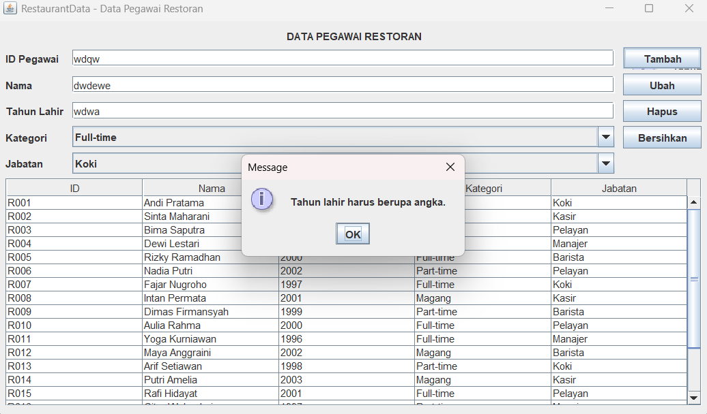

# TP4DPBO2526C1

# Janji

Saya Raffi Akbar Ardiansyah dengan NIM 2511604 mengerjakan Tugas Praktikum 4 pada Mata Kuliah Desain dan Pemrograman Berorientasi Objek (DPBO). Saya berkomitmen untuk mengerjakannya dengan jujur dan tidak melakukan kecurangan sebagaimana yang telah ditetapkan. Aamiin.

## Struktur File

text
``` 
├───Dokumentasi
│   ├───Error.png
│   ├───Hapus Data.png
│   ├───Tambah Data.png
│   ├───Tampilan Sesudah Di hapus.png
│   ├───Tampilan sesudah di update.png
│   ├───Tampilan sesudah ditambah.png
│   └───Update Data.png
│
└───PeopleMenu
    ├───out
    │   └───production
    │       └───Restoranku
    │           ├───PeopleMenu$1.class
    │           ├───PeopleMenu.class
    │           ├───Person.class
    │           ├───README.md
    │           └───com
    │               └───intellij
    │                   └───uiDesigner
    │                       └───core
    │                           ├───AbstractLayout.class
    │                           ├───DimensionInfo.class
    │                           ├───GridConstraints.class
    │                           ├───GridLayoutManager.class
    │                           ├───HorizontalInfo.class
    │                           ├───LayoutState.class
    │                           ├───Spacer.class
    │                           ├───SupportCode$TextWithMnemonic.class
    │                           ├───SupportCode.class
    │                           ├───Util.class
    │                           └───VerticalInfo.class
    │
    └───src
        ├───PeopleMenu.form
        ├───PeopleMenu.java
        └───Person.java

```

## Deskripsi Program

Program RestaurantData dibuat untuk mengelola data pegawai restoran. Aplikasi ini dikembangkan menggunakan bahasa pemrograman Java dengan antarmuka grafis (GUI) berbasis Swing dan desain form menggunakan IntelliJ UI Designer.

Program ini menyediakan fitur seperti menambahkan, menampilkan, mengubah, dan menghapus data pegawai. Data yang dikelola meliputi ID, nama, tahun lahir, kategori pegawai, dan jabatan.

## 1. Desain Class Person

Class Person digunakan untuk merepresentasikan data pegawai restoran. Class ini memiliki lima atribut dengan access modifier private, yaitu:

- id (String) : menyimpan ID pegawai
- nama (String) : menyimpan nama pegawai
- tahunLahir (int) : menyimpan tahun lahir pegawai
- kategori (String) : menyimpan kategori pegawai
- jabatan (String) : menyimpan jabatan pegawai

Class Person memiliki constructor untuk menginisialisasi data saat objek dibuat. Selain itu, terdapat method getter untuk mengambil nilai setiap atribut, yaitu:

- getId()
- getNama()
- getTahunLahir()
- getKategori()
- getJabatan()

Dengan menggunakan class Person, setiap pegawai direpresentasikan sebagai objek yang dapat dikelola oleh program.

## 2. Desain Class PeopleMenu

Class PeopleMenu adalah class utama yang mengatur tampilan antarmuka dan logika program. Class ini menggunakan JFrame sebagai jendela utama aplikasi.

Komponen yang digunakan dalam program meliputi:

- JPanel mainPanel : panel utama aplikasi
- JLabel titleLabel : label judul aplikasi
- JTextField txtId, txtNama, txtTahunLahir : menerima input ID, nama, dan tahun lahir
- JComboBox<String> cmbKategori : memilih kategori pegawai
- JComboBox<String> cmbJabatan : memilih jabatan pegawai
- JButton btnTambah, btnUbah, btnHapus, btnBersihkan : menjalankan operasi tambah, ubah, hapus, dan bersihkan
- JTable tablePegawai : menampilkan daftar data pegawai

Pilihan kategori pegawai terdiri dari:

- Full-time
- Part-time
- Magang

Pilihan jabatan pegawai terdiri dari:

- Koki
- Kasir
- Pelayan
- Manajer
- Barista

Untuk menyimpan data selama aplikasi berjalan, program menggunakan ArrayList<Person> dengan nama daftarPegawai. Data tersebut ditampilkan dalam tabel menggunakan DefaultTableModel.

Ketika aplikasi dijalankan, program langsung menampilkan 20 data pegawai contoh agar tabel tidak kosong saat pertama kali dibuka.

## 3. Fitur Program

### a. Tambah Data

Pengguna dapat menambahkan pegawai dengan mengisi ID, nama, tahun lahir, kategori, dan jabatan. Ketika tombol tambah ditekan, program memeriksa kelengkapan input dan validitas tahun lahir.

Program juga mengecek apakah ID yang dimasukkan sudah digunakan oleh pegawai lain. Jika semua pemeriksaan berhasil, data baru ditambahkan ke dalam ArrayList dan ditampilkan pada tabel. Setelah itu, form dikosongkan kembali.

### b. Menampilkan Data

Data pegawai ditampilkan dalam JTable dengan 5 kolom, yaitu:

- ID
- Nama
- Tahun Lahir
- Kategori
- Jabatan

Tabel diatur agar sel tidak dapat diedit secara langsung. Pengguna dapat memilih satu baris untuk melihat data pada form atau melakukan perubahan serta penghapusan.

### c. Mengubah Data

Pengguna memilih baris pegawai pada tabel. Setelah baris dipilih, data pegawai akan otomatis masuk ke form edit.

Kolom ID dibuat tidak dapat diedit saat data sedang dipilih. Pengguna dapat mengubah nama, tahun lahir, kategori, atau jabatan, lalu menekan tombol ubah.

Program melakukan validasi input sebelum memperbarui data di ArrayList. Setelah berhasil, tabel diperbarui dan form dikembalikan ke keadaan awal.

### d. Menghapus Data

Pengguna memilih data pegawai yang ingin dihapus, lalu menekan tombol hapus.

Program menampilkan dialog konfirmasi dengan pesan Yakin ingin menghapus data pegawai ini?. Jika pengguna memilih Yes, data akan dihapus dari ArrayList dan tabel diperbarui. Jika memilih No, proses penghapusan dibatalkan.

### e. Membersihkan Form

Tombol bersihkan digunakan untuk mengosongkan form, termasuk kolom ID, nama, dan tahun lahir. Pilihan kategori dan jabatan dikembalikan ke nilai default. Selain itu, tombol ini mengaktifkan kembali kolom ID dan menghilangkan pilihan baris pada tabel.

### f. Validasi Input

Program menggunakan method validasi() untuk memeriksa kelengkapan input dan memastikan tahun lahir merupakan angka yang valid dalam rentang 1900 sampai tahun sekarang.

Jika kolom yang wajib belum diisi atau tahun lahir tidak valid, program akan menampilkan pesan kesalahan. Program juga menolak ID yang sudah digunakan saat penambahan data.

## 4. Alur Program (Flow Kode)

Alur program dimulai dari method main() pada class PeopleMenu. Program menggunakan SwingUtilities.invokeLater() untuk menampilkan jendela aplikasi.

Setelah jendela dibuat, program melakukan beberapa inisialisasi:

- mengatur pilihan kategori dan jabatan
- membuat model tabel
- menambahkan event listener pada tombol dan tabel
- menambahkan 20 data pegawai contoh

Selanjutnya, pengguna dapat melakukan beberapa operasi, yaitu:

1. Tambah data: user mengisi form kemudian menekan tombol tambah. Program akan memvalidasi data dan memeriksa duplikasi ID sebelum menyimpan data baru.
2. Ubah data: user memilih data pada tabel, form otomatis terisi, lalu user memperbarui informasi dan menekan tombol ubah.
3. Hapus data: user memilih data pada tabel dan menekan tombol hapus. Program akan menampilkan konfirmasi sebelum menghapus data.
4. Bersihkan form: user menekan tombol bersihkan untuk mengosongkan form dan membatalkan pemilihan data.

Setelah operasi selesai, tabel akan diperbarui agar menampilkan data terbaru. Dengan demikian, seluruh pengelolaan data pegawai dapat dilakukan melalui antarmuka aplikasi.

## 5. Desain Form PeopleMenu.form

File PeopleMenu.form digunakan untuk menyimpan desain antarmuka grafis yang dibuat menggunakan IntelliJ UI Designer.

Desain form terhubung dengan class PeopleMenu.java melalui field binding. Komponen yang digunakan mencakup panel utama, label, kolom input, pilihan kategori dan jabatan, tombol operasi, serta tabel data pegawai.

Komponen tombol juga dihubungkan dengan method yang menangani operasi tambah, ubah, hapus, dan bersihkan. Sementara itu, pemilihan baris pada tabel digunakan untuk memasukkan data pegawai ke dalam form secara otomatis.

Pemisahan desain form dan logika program membantu membuat struktur kode lebih rapi dan terorganisir.

## 6. Penyimpanan Data

Program menggunakan ArrayList<Person> sebagai tempat penyimpanan data selama aplikasi berjalan. Data yang ditambahkan, diubah, atau dihapus akan memengaruhi data yang tersimpan di dalam memori dan ditampilkan pada tabel.

Program belum menggunakan database atau penyimpanan permanen, sehingga data tidak akan tersimpan secara otomatis saat aplikasi ditutup. Data hanya bertahan selama program masih berjalan.

## 7. Cara Menjalankan Program


Atau jika project sudah dikompilasi, cukup jalankan file class yang ada di folder hasil kompilasi.

## 8. Dokumentasi Tampilan Program

Berikut beberapa tampilan hasil program:


### Tambah Data


### Tampilan Setelah Ditambah


### Update Data


### Tampilan Setelah Diupdate


### Hapus Data


### tampilan sesudah Di hapus


### Error Validation


